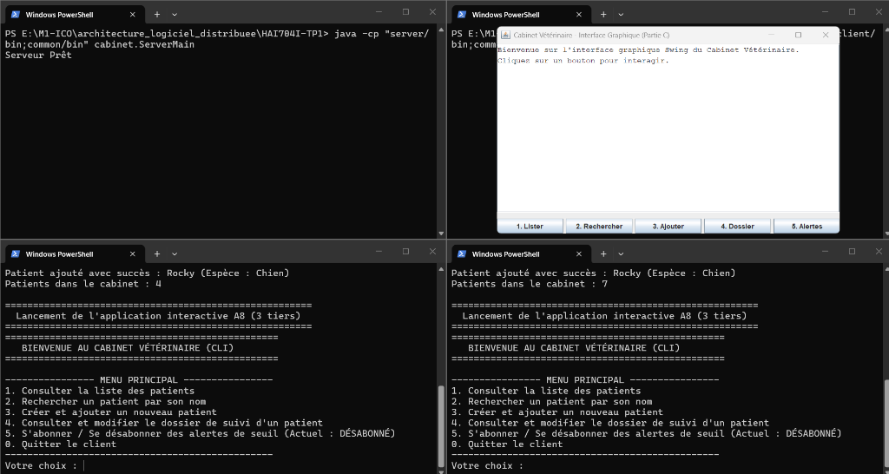

> [!WARNING]
> This is a student project. The code is not intended for production use.
> It is provided under the Apache 2.0 license. The documentation is in French.

# HAI704I - TP 1 : Java RMI (Cabinet Vétérinaire Distribué)

**Université de Montpellier** - Master 1 Informatique (Parcours ICO)  
**UE HAI704I** : Architectures Logicielles Distribuées  
**Enseignant responsable** : Bachar Rima  
**Auteur** : Léonard ADAMO  
**Numéro étudiant** : 22517746
**Dépôt GitHub** : [https://github.com/Juste-Leo2/HAI704I-TP1](https://github.com/Juste-Leo2/HAI704I-TP1)  

---

## 1. Démonstration

Une vidéo complète de démonstration multi-processus (Serveur RMI, 2 Clients CLI et Client Graphique Swing) est incluse directement dans le projet :

[](video/demonstration.mp4)

- **[Cliquez ici pour visionner la vidéo de démonstration (demonstration.mp4)](video/demonstration.mp4)**  
*(Également consultable en ligne sur GitHub : [video/demonstration.mp4](https://github.com/Juste-Leo2/HAI704I-TP1/blob/main/video/demonstration.mp4))*

---

## 2. Installation de l'Environnement (Java 21)

Le projet nécessite **Java 21 (JDK 21)**. Aucune bibliothèque tierce ni framework externe n'est requis (Java standard natif uniquement).

### Sous Linux (Ubuntu / Debian) :
```bash
sudo apt update
sudo apt install -y openjdk-21-jdk
```

### Sous Windows :
Téléchargez et installez l'exécutable JDK 21 depuis le site d'Oracle :  
- [Archive de téléchargement Oracle JDK 21](https://www.oracle.com/java/technologies/javase/jdk21-archive-downloads.html)

### Vérification de l'installation :
```bash
java -version
javac -version
```

*(Environnement de développement utilisé : Google Antigravity IDE / VS Code, testé sous Windows avec PowerShell et sous Linux avec Bash).*

---

## 3. Architecture et Rôle des Modules

Le projet est découpé en trois modules indépendants :
- **`common/`** : contrat partagé (interfaces distantes `Remote` et types sérialisables transmis par valeur).
- **`server/`** : servants RMI et création du registre local sur le port **1099**.
- **`client/`** : interfaces utilisateur (`ConsoleUI` en CLI et `SwingUI` en GUI) consommant la couche métier (`CabinetService`), sans aucune dépendance directe vers les classes du serveur.

```text
HAI704I-TP1/
├── common/                         # Module partagé
│   └── src/cabinet/
│       ├── Animal.java
│       ├── CabinetObserver.java
│       ├── CabinetVeterinaire.java
│       ├── Chien.java
│       ├── DossierSuivi.java
│       └── Espece.java
├── server/                         # Module serveur (RMI & Registre)
│   └── src/cabinet/
│       ├── AnimalImpl.java
│       ├── CabinetVeterinaireImpl.java
│       ├── DossierSuiviImpl.java
│       └── ServerMain.java
└── client/                         # Module client (CLI & GUI)
    └── src/cabinet/
        ├── CabinetService.java
        ├── ClientMain.java
        ├── ClientObserverImpl.java
        ├── ConsoleUI.java
        ├── GuiClientMain.java
        └── SwingUI.java
```

---

## 4. Compilation

Les fichiers compilés `.class` sont dirigés vers des dossiers `bin/` dédiés pour préserver la propreté du dépôt :

```bash
# 1. Module commun
javac -d common/bin common/src/cabinet/*.java

# 2. Module serveur (dépend de common)
javac -cp common/bin -d server/bin server/src/cabinet/*.java

# 3. Module client (dépend de common)
javac -cp common/bin -d client/bin client/src/cabinet/*.java
```

---

## 5. Démarrage et Exécution

Lancer les processus dans l'ordre suivant dans des terminaux distincts :

### 1. Démarrer le Serveur
Le serveur initialise le registre RMI interne sur le port standard **1099** et publie le service `CabinetVeterinaire`.

```bash
# Linux / macOS (séparateur :)
java -cp "server/bin:common/bin" cabinet.ServerMain

# Windows (séparateur ;)
java -cp "server/bin;common/bin" cabinet.ServerMain
```

### 2. Démarrer le Client Console (CLI - Étape A8)
Dans un second terminal :

```bash
# Linux / macOS
java -cp "client/bin:common/bin" cabinet.ClientMain

# Windows
java -cp "client/bin;common/bin" cabinet.ClientMain
```
*Le client exécute les vérifications automatiques (A1 à A7) puis ouvre le menu interactif :*
- `1` : Lister les patients du cabinet.
- `2` : Rechercher un animal par son nom.
- `3` : Enregistrer un nouveau patient (instancié sur le serveur).
- `4` : Consulter ou mettre à jour un dossier médical (partagé en direct).
- `5` : S'abonner / se désabonner des alertes de seuil.
- `0` : Quitter proprement.

> **Option `--no-test` :**  
> Permet de passer les tests automatiques (A1 à A7) pour lancer directement le menu interactif :  
> `java -cp "client/bin;common/bin" cabinet.ClientMain --no-test` (Windows) ou `java -cp "client/bin:common/bin" cabinet.ClientMain --no-test` (Linux/macOS).

### 3. (Bonus) Démarrer le Client Graphique (GUI Swing - Partie C)
Dans un troisième terminal :

```bash
# Linux / macOS
java -cp "client/bin:common/bin" cabinet.GuiClientMain

# Windows
java -cp "client/bin;common/bin" cabinet.GuiClientMain
```

---

## 6. Arrêt Propre

- **Client CLI** : saisir `0`. Le service appelle `UnicastRemoteObject.unexportObject(observateur, true)`, ce qui stoppe les threads d'écoute RMI et termine la JVM instantanément.
- **Client GUI** : fermer la fenêtre Swing (croix rouge) ; le hook de fermeture désabonne l'observateur.
- **Serveur** : arrêt via `Ctrl + C`.

---

## 7. Licence

Ce projet est distribué sous licence **Apache 2.0**. Consultez le fichier [LICENSE](LICENSE) pour plus de détails.
